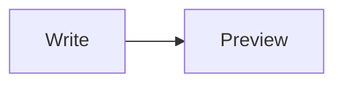

# Heading one

This paragraph has **bold**, *italic*, ~~strikethrough~~, ==highlighted== and `inline code` text, plus a #tag and a footnote[^1].

## Links

A [markdown link](https://example.com), a bare URL https://obsidian.md, a wikilink to [[Other Note]], an aliased [[Other Note|alias link]], a heading link [[Other Note#Section]] and an unresolved [[Missing Note]].

### Lists

- First bullet item that is long enough to wrap onto a second line so the hanging indent can be checked properly in the editor
- Second bullet
	- Nested bullet
		- Deeper bullet
1. Ordered one
2. Ordered two

- [ ] Open task
- [x] Finished task
- [ ] Another task with **bold** inside

> A plain blockquote that spans
> two lines.

> [!note] Callout title
> Callout body with *emphasis*.
> - list inside callout

> [!warning]
> Warning callout without a title.

> [!faq]- Folded by default
> Hidden answer, line one.
> Hidden answer, line two.

> [!tip]+ Open but foldable
> Tip body text.

---

Inline math $e^{i\pi} + 1 = 0$ and a block:

$$
\int_0^1 x^2 \, dx = \frac{1}{3}
$$

| Feature | Status | Notes |
| :------ | :----: | ----: |
| Tables | done | **bold** cell |
| Math | $x^2$ | [[Other Note]] |

```js
function greet(name) {
  return `Hello ${name}`; // comment
}
```



![[Other Note#Section]]

![[diagram.svg|200]]


Escaped \*not italic\* and %%a hidden comment%%.

[^1]: The footnote text.
